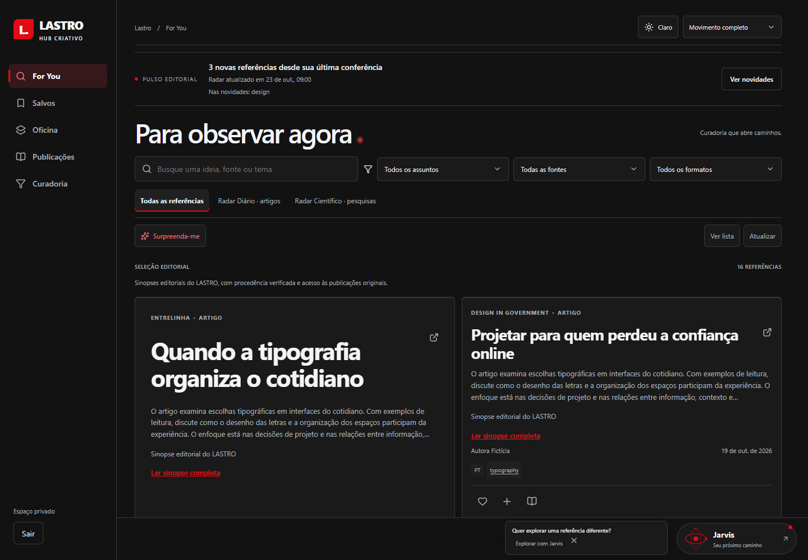
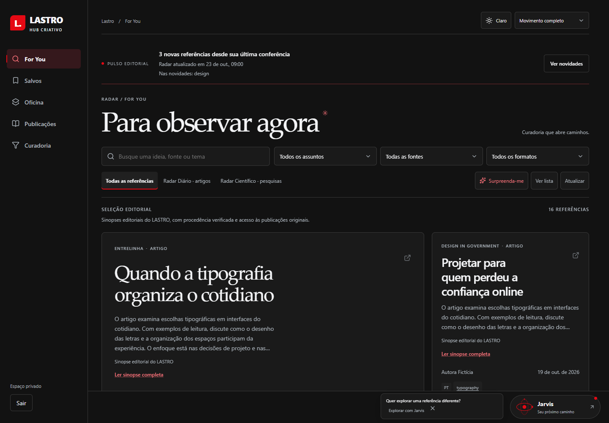
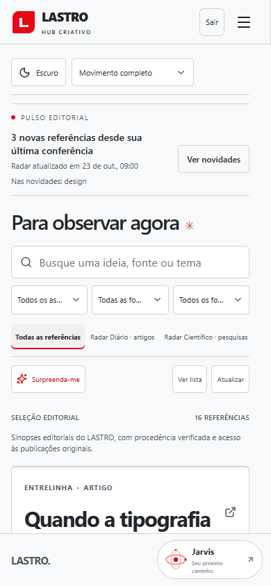
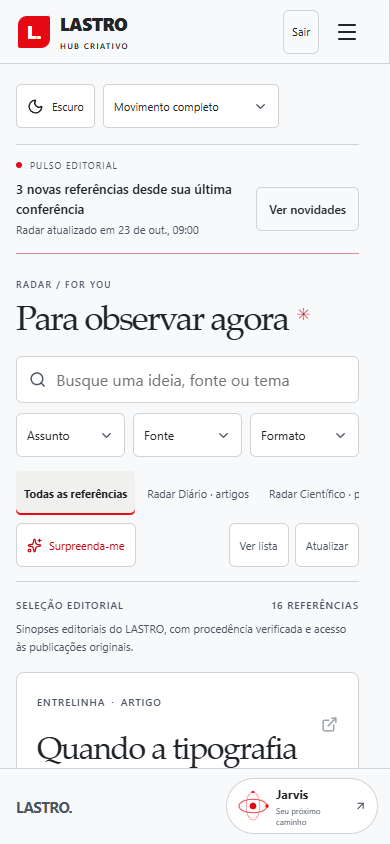

# LASTRO — refinamento editorial e de movimento

Skills aplicadas integralmente: [apple-design](../.agents/skills/apple-design/SKILL.md) e [emil-design-eng](../.agents/skills/emil-design-eng/SKILL.md). As duas instalações e o arquivo de versões ficam no projeto para reprodução em outro computador.

| Antes (Before)                                              | Depois (After)                                                                                         | Motivo                                            |
| ----------------------------------------------------------- | ------------------------------------------------------------------------------------------------------ | ------------------------------------------------- |
| Cards com entrada de 420 ms e animação adicional dos textos | Uma transição curta por estado; textos ficam estáveis                                                  | Reduzir movimentos concorrentes durante a leitura |
| Hover amplia o card em 2,5%                                 | Elevação de 2 px, sem ampliar texto                                                                    | Dar feedback sem invadir os vizinhos              |
| Hierarquia pouco expressiva e metadados pequenos            | Títulos editoriais em serifada do sistema, sinopses mais legíveis, espaçamento e alinhamento coerentes | Preservar o caráter autoral do LASTRO             |
| Filtros móveis com rótulos cortados                         | Assunto, Fonte e Formato com alvos de 44 px                                                            | Melhorar leitura e toque sem esconder controles   |
| Menus com entrada genérica e fechamento abrupto             | Origem calculada no botão e entrada/saída reversíveis a partir do estado visual atual                  | Manter continuidade espacial                      |
| Ações de teclado também animadas                            | Teclado imediato; movimentos retomam com o ponteiro                                                    | Responder com precisão ao modo de entrada         |
| Nova busca desmonta a seleção visível                       | Referências anteriores permanecem com indicação de atualização até a resposta                          | Evitar flashes e perda de contexto                |
| Mensagem de confirmação altera a altura do cabeçalho        | Feedback em camada fixa, com reversão visual em falhas                                                 | Preservar a posição dos cards                     |

## Implementação

For You conserva a ordem recebida da API. O destaque inicial usa a própria primeira referência; composição, sinopses, links e autoria mantêm sua função. Pulso editorial, busca, recortes e ações formam uma sequência visual integrada. Salvar, selecionar e marcar leitura continuam com feedback otimista e as mesmas chamadas existentes.

Menus e Jarvis usam Web Animations API, sem biblioteca adicional. Reabrir durante a saída parte do valor apresentado. A troca cards/lista captura os retângulos atuais antes de cancelar a animação anterior e só anima referências próximas à área visível. As animações programáticas usam transform e opacidade, com duração de 120–240 ms. Transições de seção preservam posição de leitura e deixam os controles disponíveis durante o movimento.

Salvos, Oficina e Curadoria reutilizam tipografia, espaçamento, estados vazios, confirmações e controles. Os dois temas, foco visível, navegação por teclado, toque e preferência do sistema por movimento reduzido foram preservados. Trocar para movimento reduzido interrompe também animações já iniciadas. A identidade em preto, branco e vermelho e o símbolo LASTRO permanecem próprios.

## Comparação visual

Mesmos dados de teste, posições e tamanhos; as capturas não representam novos conteúdos publicados.

| Antes — desktop                                                 | Depois — desktop                                                |
| --------------------------------------------------------------- | --------------------------------------------------------------- |
|  |  |

| Antes — mobile                                                | Depois — mobile                                               |
| ------------------------------------------------------------- | ------------------------------------------------------------- |
|  |  |

Também foram conferidas as versões desktop clara e mobile escura.

## Verificação

- `npm run verify`: 81 testes gerais, verificações de tipos e build aprovados.
- Interface: 29 testes aprovados; uma gravação demonstrativa opcional ignorada. Cobertura de 320, 390, 768, 1366 e 1440 px, temas, contraste, teclado, foco, movimento reduzido, toque em contexto mobile emulado, erros, persistência, paginação e retorno à posição de leitura. O ajuste final de alternância teclado/ponteiro também passou em teste dirigido.
- JavaScript comprimido: 123,54 KB, comparado a 122,63 KB da base. CSS comprimido: 11,15 KB. Nenhuma dependência ou fonte remota adicionada. Esses tamanhos não substituem uma medição em aparelhos físicos.
- Comparação do Git confirma ausência de mudanças no backend, contratos, migrações, dependências e configuração do Worker. Pipeline editorial, Workers AI, Cron, D1, autenticação, ranking e regras de aprovação não foram alterados.

Deploy: `dbab911e-a0b6-407a-809d-0b9ade703426`, https://lastro.marioserafim.com.br/. A validação posterior conferiu os assets publicados, autenticação e preservação dos 62 registros, incluindo as 16 sinopses, os 38 bloqueados, favoritos e seleção. For You permanece com 8 PT/8 internacionais, sem duplicações ou nova inferência de IA. Não foi necessária migração.
